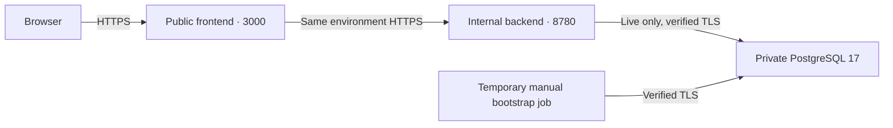

# Predictir Azure edition

The default root supports local replay without cloud credentials, a registry or a database. The separately initialized [hosted root](hosted/) manages Azure deployments. Keep its Terraform state and resource names separate from existing Predictir infrastructure.

| Profile | Workloads | Persistent services |
| --- | --- | --- |
| Local replay | Local front and backend using embedded fixtures | None |
| Hosted replay | Public front and environment-only backend on Azure Container Apps Consumption | Existing Azure Container Registry |
| Live foundation | Private database and network, with a temporary manual initialization job when requested | Existing registry and Key Vault, Azure PostgreSQL 17, private DNS |
| Hosted live | Public front and environment-only backend, launched after database initialization | Existing registry and Key Vault, Azure PostgreSQL 17, private DNS |

The frontend uses HTTPS to reach the backend inside its Container Apps environment. Frontend and backend listen on 3000 and 8780 respectively. Both use a single active revision and default to scaling between zero and one replica. With `keep_apps_warm = true`, each app keeps one replica ready. The frontend probes its local page and the backend probes its local health route. Each requires one successful readiness response. The frontend's public `/api/health` remains an end-to-end release check.



## Verify locally

From the repository root:

```sh
terraform -chdir=terraform/azure init -backend=false
terraform -chdir=terraform/azure plan -input=false
terraform -chdir=terraform/azure/hosted init -backend=false -lockfile=readonly
terraform -chdir=terraform/azure/hosted validate
terraform -chdir=terraform/azure/hosted test
bash terraform/azure/ci-images.sh
```

The offline plan creates zero resources. Hosted tests mock AzureRM and require no Azure authentication. The image checks build the replay frontend, live frontend, shared backend and bootstrap job. They verify replay with container networking disabled and execute bootstrap twice against a disposable PostgreSQL 17 fixture over verified TLS.

## Hosted release prerequisites

- Use Terraform 1.17.1 with the committed AzureRM lock, Azure CLI, Bash and `jq`. Authenticate to the selected Azure subscription. Verify East US 2 quota and B1ms availability. Review applicable registrations for Microsoft.App, Microsoft.Network, Microsoft.DBforPostgreSQL, Microsoft.ManagedIdentity, Microsoft.ContainerRegistry and Microsoft.KeyVault. Terraform's hosted provider does not auto-register services. [AzureRM authentication](https://registry.terraform.io/providers/hashicorp/azurerm/5.12.0/docs) · [Azure providers](https://learn.microsoft.com/azure/azure-resource-manager/management/resource-providers-and-types)
- Use an existing authenticated ACR in the same subscription. Basic is sufficient for the expected image volume. Disable the registry admin account, allow ARM audience tokens for ACA managed-identity pulls, and check network reachability from the Container Apps environment and approved publisher. The hosted root uses one pull identity per workload. ABAC restricts each identity to its own repository. A registry in RBAC-only mode grants registry-wide pull. [Managed identity pulls](https://learn.microsoft.com/azure/container-apps/managed-identity-image-pull) · [Repository-scoped ABAC](https://learn.microsoft.com/azure/container-registry/container-registry-rbac-abac-repository-permissions)
- Live requires an existing Standard Key Vault with Azure RBAC, a narrow data-plane path for the operator and ACA, and permission for Terraform to assign secret-scoped roles. The live ACA subnet enables the Key Vault service endpoint. If the vault uses selected networks, authorize that subnet using the vault's owning configuration. If the vault uses a private endpoint, verify that the app environment reaches the endpoint and resolves its private DNS. The hosted root leaves existing vault firewall rules to their owner. [Key Vault service endpoints](https://learn.microsoft.com/azure/key-vault/general/overview-vnet-service-endpoints) · [ACA secret references](https://learn.microsoft.com/azure/container-apps/manage-secrets)
- Use a secure state backend with locking for shared operations. Keep private inputs and saved plans outside Git. Use distinct Terraform states for the registry/vault foundation and the hosted app root. Set an explicit monthly spend approval and a reviewed estimate that includes all affected Azure services.

## Publish immutable images

The Azure GitHub workflow verifies code, Terraform and the four images without cloud access. For a hosted release, configure the protected GitHub environment `azure-image-publish` for `main` with a required reviewer. Configure a federated credential with subject `repo:<owner>/<repo>:environment:azure-image-publish` and audience `api://AzureADTokenExchange`. Set `AZURE_CLIENT_ID`, `AZURE_TENANT_ID`, `AZURE_SUBSCRIPTION_ID` and `AZURE_ACR_NAME` as environment variables in GitHub. Set the repository variable `AZURE_IMAGE_PUBLISH_ENABLED=true` only for approved publication and select `publish_images` in a manual workflow run.

Grant the publisher registry read metadata and `Container Registry Repository Writer` scoped to `predictir-replay-front`, `predictir-live-front`, `predictir-backend` and `predictir-bootstrap` on an ABAC registry. In RBAC-only mode use `AcrPush` on that registry. The publisher needs no app, job, database, vault or Terraform state access. It builds and tests the images in its protected job, publishes those exact images, and prints their digests. Terraform uses the selected digests to deploy revisions. [Azure GitHub OIDC](https://learn.microsoft.com/azure/developer/github/connect-from-azure-openid-connect) · [ACR role scopes](https://learn.microsoft.com/azure/container-registry/container-registry-rbac-built-in-roles-overview)

## Deploy hosted replay

Select `profile = "replay"` and the replay frontend and shared backend digests. Set `azure_enabled = true`, `subscription_id`, `existing_acr` and `spend_approval` using the [example inputs](hosted/terraform.tfvars.example). Review the plan for two Consumption apps, private backend ingress and no database or runtime secrets. Apply only the approved plan. Verify the public `/api/health` reports replay and zero provider calls, and `/api/workspace/replay` returns the replay data.

## Deploy hosted live

1. Select `profile = "live"`, the live frontend and shared backend digests, and the existing ACR. Leave `launch_live_apps = false` and `live_bootstrap` unset. Supply `TF_VAR_postgres_admin_password` as a masked private environment input to plan and apply. Use the same private password in later plans until deliberately rotating it with `postgres_admin_password_version`. Terraform sends it through the provider's write-only field. Review and apply the private PostgreSQL foundation. PostgreSQL uses a dedicated delegated subnet, a linked private DNS zone, inbound TCP 5432 restricted to the app and database subnets, encrypted transport, and seven days of local backups. Review an explicit backup and recovery plan before any future retirement or replacement.
2. Read the `postgresql` and `container_apps_subnet_id` outputs. Establish the vault network path. Add versioned Key Vault secrets for the values below. Source the CA bundle from the roots Microsoft documents for PostgreSQL and verify the bundle before storing it. Enter version-pinned URIs in `live_secrets` and `live_bootstrap`, and use the bootstrap image digest from the same tested release. [Private PostgreSQL networking](https://learn.microsoft.com/azure/postgresql/network/concepts-networking-private) · [PostgreSQL TLS root certificates](https://learn.microsoft.com/azure/postgresql/security/security-tls-how-to-connect)

| Secret | Scope and format |
| --- | --- |
| Edge | `MARKET_EDGE_SECRET` in front and backend. Generate a strong random value of at least 32 characters. |
| Assistant | `ASSISTANT_SERVICE_SECRET` in front and backend. Use a separate strong random value. |
| Account | `ACCOUNT_COOKIE_SECRET` in backend only. Use a separate strong random value. |
| Database URL | `postgresql://market_lab_app:<base64url-password>@<exact-postgresql-output-host>:5432/predictir`. Generate 32 to 128 URL-safe password characters and omit query options. |
| Database CA | Combined trusted Azure root PEMs, referenced by the backend and bootstrap. |
| Administrator password | The same private value passed to Terraform for PostgreSQL. Only the temporary bootstrap identity receives this reference. |

3. Review and apply a plan with the manual bootstrap job and no web apps. Let Key Vault and ACR role grants propagate. Start the exact job and wait for its successful execution:

```sh
bash terraform/azure/hosted/run-bootstrap.sh
```

The job connects from the delegated ACA subnet with `sslmode=verify-full`. It creates the bounded `market_lab_app` login, installs pgcrypto, applies the canonical `web/database/001_market_lab.sql` through `006_public_evidence.sql`, and grants only the operations required on older RLS-protected tables. PostgreSQL uses vector when available and the application retains its array fallback. The job reconnects as the runtime login and probes portfolio compare-and-swap, journal settlement and immutability, leases, quotas, source history and job transitions. The probes roll back their rows. A retry reuses the same version-pinned secrets and schema after confirming any previous execution is terminal.

4. Remove `live_bootstrap` in a separate reviewed plan. Verify the job, its identity, and its administrator secret grant are removed. Retire the bootstrap password secret version according to your vault policy. Keep administrator access available through your approved private maintenance procedure.
5. Set `live_database_ready = true` and `launch_live_apps = true`, then review and apply the live app plan. Verify the published frontend origin and end-to-end `/api/health`. Confirm a direct request from outside the environment to the internal backend URL receives the platform's rejection. Verify one intended market read and, where owner auth is enabled, the owner sign-in and persisted paper portfolio. Use the previously approved image digests for a revision rollback through Terraform. [ACA ingress](https://learn.microsoft.com/azure/container-apps/ingress)

Optional single-owner authentication uses `live_owner` and an existing single-tenant Entra application. Register the Azure frontend callback expected by the app, verify the tenant/client/object identifiers, and restrict access to the intended user. Omit `live_owner` to leave this feature off.

Foundry remains off by default. A later, separately budgeted configuration can use an existing compatible Azure model deployment and the frontend user-assigned identity from `front_identity`. Grant the identity inference access only to the intended existing Azure resource. The frontend receives `AZURE_CLIENT_ID`, `AZURE_FOUNDRY_ENABLED=1`, `AZURE_FOUNDRY_ENDPOINT` and `AZURE_FOUNDRY_DEPLOYMENT`. The backend receives `AZURE_FOUNDRY_ENABLED=1`, `AZURE_FOUNDRY_DAILY_CALLS` and `AZURE_FOUNDRY_MONTHLY_CALLS`. Review any future environment changes through Terraform.

The trial profile uses shared public Kalshi snapshots when a streaming key is unavailable. The backend polls a selected book no faster than once every eight seconds and keeps the original observation timestamp. The interface identifies the data as polled. The app allows 2,400 stream minutes per month and up to 2,400 upstream poll reads per day. Forecast and execution methods receive the same evidence and keep their existing validation gates.

Use `node terraform/azure/hosted/verify-live.mjs <frontend-origin> --backend <internal-backend-origin>` after release. It verifies public health, the market catalog, contract-specific research, grounded MCP coverage and external rejection of the private backend. The optional `--compare` flag checks the same public contract on the existing Predictir edition when both catalogs include it.

## Observe a release

Use Azure Monitor's platform metrics for requests by status, replicas, restarts, CPU and memory, and PostgreSQL metrics for connections, CPU and storage. The platform's ACA response-time metric is an average. The private backend diagnostic endpoint provides process-local p95/p99 with sample counts. Use its service credential only from the trusted environment and account for replica restarts and scale-to-zero resets. Read metrics on demand and stream ACA console or system logs during an incident. Terraform leaves log retention off and creates no Log Analytics workspace, diagnostic sink, dedicated compute or NAT gateway. [ACA metrics](https://learn.microsoft.com/azure/container-apps/metrics) · [ACA log destinations](https://learn.microsoft.com/azure/container-apps/log-options) · [PostgreSQL metrics](https://learn.microsoft.com/azure/postgresql/monitor/concepts-monitoring)

## Private operational reviews

The backend serves a separate MCP endpoint at `/internal/operator-mcp` for service-authenticated operational reviews. It is reachable within the Azure environment and uses the existing service secret. The public frontend does not forward this endpoint.

- `review_runtime` reports measured API latency, failures and the recorded reasons for stream throttles.
- `review_sources` reviews recorded provider latency and errors using observations already collected by the backend.
- `review_allowances` reads stored work and assistant allowances and identifies records above 80% usage.

Each tool returns its observation scope and time, plus proposed actions for review. Runtime measurements cover the current process and reset on restart. Application allowances measure reservations. Provider billing remains a separate source.

MCP clients connect from a trusted workload using Streamable HTTP and the existing `ASSISTANT_SERVICE_SECRET` bearer credential. Access uses the same internal authorization as diagnostics. Keep that credential in Key Vault or the caller's protected environment.

## Regional cost basis

Public USD retail rates checked November 5, 2026. Subscription terms and actual consumption determine the bill. [Azure retail pricing API](https://learn.microsoft.com/rest/api/cost-management/retail-prices/azure-retail-prices)

| Meter | East US 2 basis |
| --- | --- |
| PostgreSQL B1ms | $0.017 per hour × 730 = $12.41 |
| PostgreSQL 32 GiB Premium storage | $0.115 per GiB per month = $3.68 |
| One private DNS zone | $0.50 per month in the first tier |
| Live database and DNS base | **$16.59 per 730-hour month** |
| ACR Basic if separately added | $0.1666 per day, about $5 for 30 days |
| Standard Key Vault secret operations | $0.03 per 10,000 operations |
| Container Apps active usage | $0.000024 per vCPU-second and $0.000003 per GiB-second above the shared grant |
| Container Apps requests | $0.40 per million above the shared grant |

Central US B1ms costs $0.01921 per hour and standard PostgreSQL storage costs $0.13 per GiB per month. The Central US database and private DNS base is about $18.69 for 730 hours before account credits. Use the subscription's regional PostgreSQL SKU list to verify that PostgreSQL 17 and B1ms are available before applying. A Free Trial subscription can also restrict the number of Container Apps environments.

Container Apps grants are 180,000 vCPU-seconds, 360,000 GiB-seconds and two million requests per subscription per month. One hour a day with both replay replicas active uses about 54,000 vCPU-seconds and 108,000 GiB-seconds over 30 days. Both live replicas active continuously for 730 hours would cost about $59.13 in container compute before free grants, plus the database, requests and other meters. A full five-minute bootstrap run uses 75 vCPU-seconds and 150 GiB-seconds. Data transfer, DNS queries, excess backups, registry storage above included capacity and optional model usage are separate. [ACA pricing](https://azure.microsoft.com/pricing/details/container-apps/) · [PostgreSQL pricing](https://azure.microsoft.com/pricing/details/postgresql/flexible-server/) · [ACR pricing](https://azure.microsoft.com/pricing/details/container-registry/) · [Key Vault pricing](https://azure.microsoft.com/pricing/details/key-vault/)

The hosted root requires a reviewed limit of at least $1 for replay or $25 for live. For a credit-only trial, set `credit_only = true` and `accepts_metered_overages = false`. Before each apply, check the selected subscription's ARM `subscriptionPolicies.spendingLimit` is `On` and its credit window is still open. The Terraform inputs record that verification. Azure applies the spending limit and ends Free Trial services when credits run out or expire. [Azure spending limits](https://learn.microsoft.com/azure/cost-management-billing/manage/spending-limit)

For a public demo that needs immediate access after idle periods, enable `keep_apps_warm` and include continuous compute in the reviewed estimate. At Central US retail rates, both live replicas idle for 730 hours add about $17.74 before free grants. Active usage can bring that to about $59.13 before grants. Public traffic and background work affect how often idle rates apply. Turn `keep_apps_warm` off to restore scale to zero. [Container Apps billing](https://learn.microsoft.com/azure/container-apps/billing)
